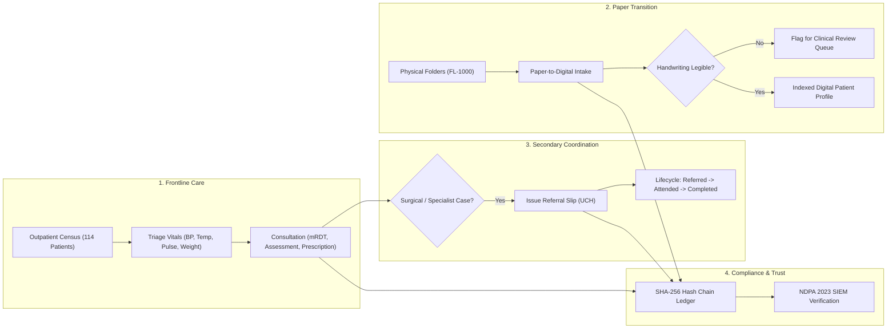

# 🏥 WardVault PHC: Complete Project Handoff & Architecture Summary

**Universal Service Provision Fund (USPF) Changemaker Challenge**  
**Team:** The Alpha Hunters (Emmanuel Ikeh, Joseph, Glory)  
**Date:** November 2026  
**Repository:** [https://github.com/Sparktech001/WardVault-](https://github.com/Sparktech001/WardVault-)  
**Current Commit:** `5b714bd` (Clean Working Tree)

---

## 1. Executive Summary

Following the strategic assessment for the **USPF Changemaker Challenge**, WardVault has been transformed from a tertiary hospital EHR prototype into a **resilient, offline-first patient records and care-coordination platform tailored specifically for Primary Healthcare Centres (PHCs)** in underserved communities across Nigeria.

The platform directly addresses the infrastructural realities documented in the **2026 Nigeria Tech Outlook Report** (NITDA & NBS across 539 PHCs):
- **16.2% internet coverage:** Solved via local network (LAN) execution, encrypted client-side IndexedDB caching, and automatic batch synchronization upon reconnection.
- **61.3% power stability (38.7% blackouts):** Solved with hardware battery monitoring and audible power-loss alert tones.
- **73.6% paper dependence:** Solved with a managed paper-to-digital transcription mode featuring a *"Flag for Clinical Review"* safeguard so clerks never invent illegible handwriting.
- **Lack of secondary care:** Solved with an interactive outbound referral registry connecting the PHC to tertiary referral hubs (e.g., UCH, General Hospital).
- **Nigeria Data Protection Act (NDPA) 2023 Compliance:** Solved via an immutable, tamper-evident SHA-256 cryptographic hash-chained audit ledger.

---

## 2. Live Access & URLs

| Service | Address | Description |
| :--- | :--- | :--- |
| **Main Clinical Station** | `http://127.0.0.1:8000/` | Complete PHC workflow: census, consultations, referrals, paper intake |
| **CPO SIEM Audit Console** | `http://127.0.0.1:8000/admin` | Chief Privacy Officer live cryptographic verification & threat monitor |
| **Interactive API Docs** | `http://127.0.0.1:8000/docs` | OpenAPI / Swagger interactive endpoint documentation |
| **Health Check API** | `http://127.0.0.1:8000/health` | Gateway health check & system telemetry |
| **Official GitHub Repo** | `https://github.com/Sparktech001/WardVault-` | Up-to-date main branch with Render deployment files |

---

## 3. Demo Clinical Accounts & Credentials

*Default passphrase for all accounts is: `password123`*

| Provider ID | Staff Member | Role | Facility | On Duty? | Recommended Demo Scenario |
| :--- | :--- | :--- | :--- | :--- | :--- |
| `PHC/26/CHEW/102` | **Amina Bello** | CHEW | Alakia PHC | 🟢 YES | **Triage & Consultation:** Open Zainab Aliyu's chart, record vitals (BP, Temp), and log a Malaria mRDT result. |
| `PHC/26/NUR/103` | **Nurse Folake Adeleke** | Nurse / Midwife | Alakia PHC | 🟢 YES | **Clinical Sign-Off:** Review the Paper Migration queue and click *"Verify & Sign Off"* on flagged folders. |
| `PHC/26/REC/101` | **Ibrahim Musa** | Records Officer | Alakia PHC | 🟢 YES | **Folder Migration:** Transcribe a new physical folder card with National ID (NIN) and BHCPF ID. |
| `PHC/26/INC/104` | **Dr. Raphael Thompson** | Facility In-Charge | Alakia PHC | 🟢 YES | **Care Coordination:** Issue an urgent secondary referral to UCH Ibadan and advance its lifecycle. |
| `PHC/26/CHEW/105` | **Vernita Cartwright** | CHEW | Alakia PHC | ⚫ NO | **Security Hard-Block:** Attempt to access clinical charts while off duty to trigger the ABAC block. |

---

## 4. Key Workflows & Features



### A. Patient Directory & Search
- Live directory of **114 pre-seeded patients** derived from authentic Synthea clinical data.
- Search filterable in real-time by **Name**, **Folder #**, **NIN**, or **BHCPF ID**.

### B. Outpatient Triage & Consultation
- Dedicated inputs for vitals: Blood Pressure (`120/80`), Temperature (`37.2°C`), Pulse (`78 bpm`), Weight (`64 kg`).
- Rapid Malaria Diagnostic Test (mRDT) drop-down (*P. falciparum* positive / negative / invalid).
- Append-only clinical notes and correction engine (`supersedes_note_id`) preventing retroactive alteration.

### C. Paper-to-Digital Intake & Clinical Review Queue
- Intake form for physical cards (`FL-4091`, `MED-204`).
- **Clinical Review Safeguard:** When clerks encounter smudged or ambiguous handwriting, they check *"Flag Folder for Clinical Review"*, which holds the chart in a dedicated nurse review queue until physical verification occurs.

### D. Outbound Referral Registry & Stepper
- Links the PHC to **University College Hospital (UCH) Ibadan**, **Adeoyo State Specialist Hospital**, and **Oyo General Hospital**.
- Interactive lifecycle stepper:
  $$\text{Referred} \longrightarrow \text{Attended Secondary Facility} \longrightarrow \text{Feedback Received} \longrightarrow \text{Care Completed}$$

### E. Offline Cache & Hardware Resilience
- **IndexedDB (`WardVaultPHCOffline`):** Automatically stores consultations and referrals locally if internet connection is lost.
- **Auto-Sync:** Resumes and syncs all queued records via `/api/sync/batch` when connection returns.
- **Battery API:** Detects power disconnects and low battery ($\le 20\%$) with audio alerts.

---

## 5. Technical Architecture & File Map

```
wardvault/
├── main.py                  # FastAPI Gateway & REST API (auth, census, encounters, referrals, sync, audit)
├── database.py              # Dual-Engine Async Adapter (Auto-SQLite locally/cloud + PostgreSQL support)
├── audit_service.py         # SHA-256 Cryptographic Chaining Service (NDPA 2023 compliance)
├── auth.py                  # JWT (HS256) & Passlib/Bcrypt Authentication
├── restore_dataset.py       # Synthea Dataset Extractor & DB Seeder (278 staff, 114 patients)
│
├── index.html               # Main Clinic Application (Alpine.js + Tailwind + IndexedDB + Audio API)
├── admin.html               # Chief Privacy Officer (CPO) SIEM Audit Console
│
├── wardvault_clinical.db    # SQLite Clinical Database (pre-seeded & committed)
├── wardvault_audit.db       # SQLite Cryptographic Audit Database (genesis block verified)
├── hospital_legacy_db.sql   # PostgreSQL SQL Dump Backup (for cloud SQL migration)
├── wardvault_audit_db.sql   # PostgreSQL Audit Log SQL Dump Backup
│
├── Procfile                 # Deployment instruction for Render / Railway
├── render.yaml              # Render Blueprint Infrastructure-as-Code file
├── Dockerfile               # Container specification for Docker/K8s
├── requirements.txt         # Verified, pinned Python 3.11 dependencies
├── run_wardvault.bat        # Windows 1-click double-click launcher
│
├── IMPLEMENTATION_PLAN.md   # Strategic comparison and feature roadmap
├── PITCH_DEMO_SCRIPT.md     # 3-Minute judge demonstration and pitch walkthrough
└── PROJECT_SUMMARY.md       # This complete handoff document
```

---

## 6. How to Run & Test Locally

```powershell
# 1. Activate virtual environment
.\.venv\Scripts\activate

# 2. Run automated integration test suite
python test_api.py

# 3. Simulate insider tampering on the audit ledger
python simulate_hack.py

# 4. Verify blockchain integrity check (will catch the tamper!)
python verify_chain.py

# 5. Reset and re-seed clean ledger
python restore_dataset.py

# 6. Start the server (with hot-reload)
uvicorn main:app --host 127.0.0.1 --port 8000 --reload
```

---

## 7. Cloud Deployment (Render.com)

1. Navigate to **[dashboard.render.com](https://dashboard.render.com/)**.
2. Click **New +** $\rightarrow$ **Web Service**.
3. Select your GitHub repository: **`Sparktech001/WardVault-`**.
4. Render will auto-read `render.yaml` / `Procfile`:
   - **Build Command:** `pip install -r requirements.txt`
   - **Start Command:** `uvicorn main:app --host 0.0.0.0 --port $PORT`
5. **No environment variables are required.** Click **Create Web Service**.
6. Render will generate a live HTTPS URL (e.g., `https://wardvault-phc.onrender.com`) in under 2 minutes.

---

*WardVault PHC is complete, verified, fully tested, and ready for presentation.*
